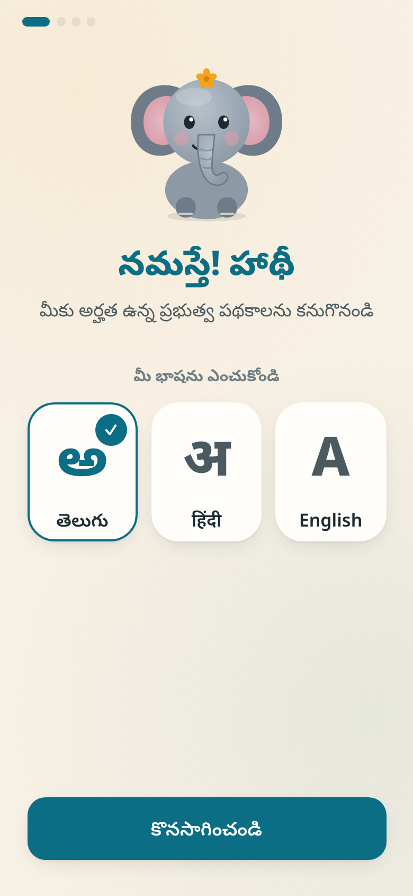
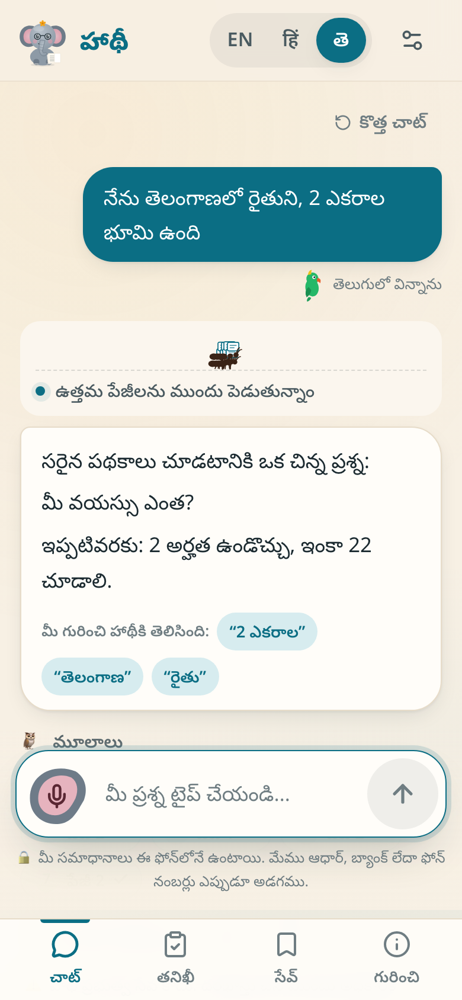
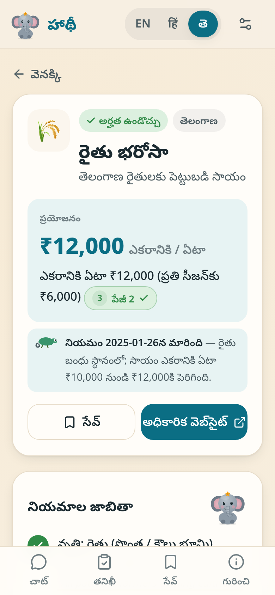
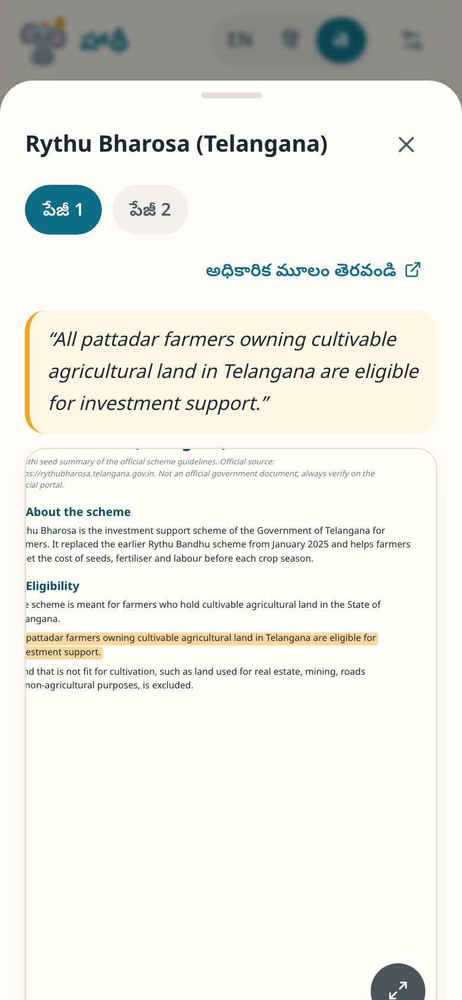
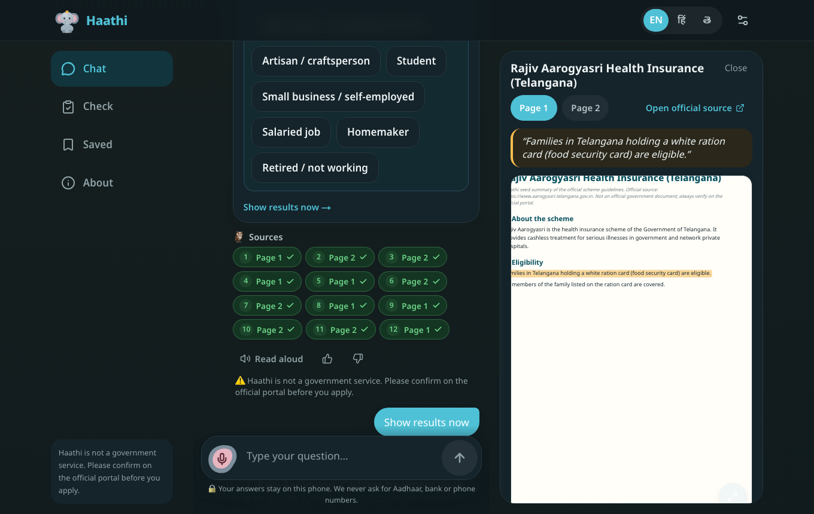
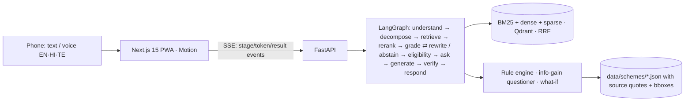

# 🐘 Haathi — find government schemes, with proof

Ask in **Telugu, Hindi or English**, typed or spoken (Tenglish and Hinglish work too). Haathi finds the
government schemes you're likely eligible for. It proves each one with the exact sentence from the scheme
guidelines and tells you which documents to bring and how to apply. It covers central, **Telangana** and
Andhra Pradesh schemes. It's a phone-first web app (PWA) and runs at ₹0.

### 🔗 Live demo: **[haathi-ten.vercel.app](https://haathi-ten.vercel.app)**

Open it on your phone and try *"నేను తెలంగాణలో రైతుని, 2 ఎకరాల భూమి ఉంది"*, or tap Gajju's ear and speak.
The demo runs on free hosting, so the first visit after a quiet spell can take about a minute while the server wakes up
(a banner tells you). To fit the free 512 MB server it uses the **light engine** (hashing embedder + lexical reranker)
with Gemini. The full-model numbers below come from running Haathi locally; the live site's numbers are in
[`eval/reports/live_light_engine.md`](eval/reports/live_light_engine.md).

> ⚠️ Haathi is not a government service and is not affiliated with any government. Always confirm on the
> official portal before you apply.

| Welcome | Ants search, parrot hears Telugu | Results + freshness 🦎 | Source with highlight |
|---|---|---|---|
|  |  |  |  |

Desktop (dark): chat on the left, source viewer on the right.


---

## Run it on your Mac

```bash
make setup      # uv sync (Python 3.12) + npm install
make ingest     # parse → chunk → contextualize → index (seconds with the light engine)
make dev        # backend :8000 + frontend :3000
make phone      # prints http://<your-Mac-IP>:3000 to open on your phone (same Wi-Fi)
```

It needs no Docker, no API key and no model download. Every part has a deterministic fallback:

| Part | Full mode | Zero-setup fallback (default when missing) |
|---|---|---|
| Embeddings | **BGE-M3** dense + sparse on the Mac GPU (MPS) — `make setup-ml` | char-n-gram hashing embedder + hashed sparse |
| Reranker | **bge-reranker-v2-m3** | lexical/char-gram reranker (max over original + English query) |
| LLM | **Gemini** (`GEMINI_API_KEY` in `backend/.env`) → flash-lite fallback → Ollama | structured templates (en/hi/te) + extractive answers |
| Parsing | **Docling** for official PDFs/HTML | deterministic layout engine for the seed summaries |
| Vector DB | Qdrant server (`make services`) | Qdrant in-process (`:memory:`, rebuilt from cached vectors) |
| Speech-to-text | Browser Web Speech API (te-IN / hi-IN / en-IN), Gemini audio | typing |

Voice on a phone needs HTTPS: `cloudflared tunnel --url http://localhost:3000`.

Other targets: `make test`, `make eval`, `make loadtest`, `make freshness`, `make ingest-download`
(polite download of official docs from `data/manifest.csv`; Telangana G.O.s come from `goir.telangana.gov.in`), `make icons`. The rule review UI is at
`http://localhost:3000/admin` and the animation playground at `/playground`.

---

## What makes it different

1. **Eligibility engine with proof.** Rules live as JSON (`data/schemes/*.json`, Rule DSL in §6 of
   `haathi.md`), and each rule quotes the exact sentence and page it comes from. Plain Python with Kleene
   three-valued logic decides eligible / not eligible / maybe. It also splits cases exhaustively over
   finite fields, so `(rural AND income ≤ 1.5L) OR (urban AND income ≤ 2L)` gets decided once both branches
   agree. The AI never decides numbers.
2. **Smart questioning.** The next question is the one with the highest expected information gain over the
   schemes still open, estimated by Monte-Carlo completion from field priors (Telangana-first).
3. **What-if.** For example: "You'd qualify for Kalyana Lakshmi if your family income were ₹1,50,000 or less
   (now ₹1,80,000)." It only suggests changes a person could actually reach. It never suggests "be younger".
4. **Code-mixed and romanised input.** "nenu raithu ni, naku 2 ekaralu undi" and "mera income 2 lakh hai"
   both work. Facts keep their provenance ("you said '2 ఎకరాల'"). Facts are only taken from first-person
   statements, so "pension for workers?" isn't stored as a fact about you.
5. **Highlighted citations.** Each chip opens the source page. Gajju zooms to the passage and a marigold
   highlight sweeps across the exact characters.
6. **Calibrated "I don't know".** The abstention threshold is chosen from a risk–coverage sweep.
7. **Freshness.** Old names map to current schemes (Rythu Bandhu → Rythu Bharosa, Amma Vodi → Thalliki
   Vandanam), with a 🦎 "rule changed on…" note. The weekly re-download diffs each document, keeps the old
   version and queues re-extraction.
8. **Open benchmark.** SchemeQA-Indic v0 (`eval/schemeqa/`) comes with a datasheet.
9. **Measured design.** Every technique sits behind a flag and is listed in the ablation table.
10. **Animals that explain the system.** All 20 moments from §9.3 are original SVG + Motion art. There's a
    Full / Calm / Off setting, and Reduce Motion is respected.

---

## Results (real numbers, `make eval`)

Engine for all tables: **light fallback** (hashing embedder, lexical reranker, no LLM), MacBook Apple M5.
Benchmark: **SchemeQA-Indic v0, 69 items (23 en / 23 hi / 23 te), author-draft, not yet human-verified**,
so treat the numbers as a development signal. Rerun with `make setup-ml` and `GEMINI_API_KEY` for full-model
numbers.

### Overall (`eval/reports/baseline.md`)

Full models (BGE-M3 + bge-reranker-v2-m3 on the Mac GPU, Gemini off), corpus = 30 scheme summaries **plus 15
official documents** (2,149 passages):

| | Recall@5 | MRR | key-fact correctness | eligibility F1 | abstain on unanswerable | false abstain | citations supported | p50 / p95 |
|---|---|---|---|---|---|---|---|---|
| **all** | **98.0** | **0.905** | 95.9 | 100.0 | **100.0** | 1.7 | 99.4 | 1.9 / 4.8 s |
| English | 100.0 | 1.000 | 93.8 | 100.0 | 100.0 | 0.0 | 99.6 | |
| Hindi | 100.0 | 0.843 | 100.0 | 100.0 | 100.0 | 0.0 | 99.0 | |
| Telugu | 93.8 | 0.875 | 93.8 | 100.0 | 100.0 | 5.0 | 99.5 | |
| *light engine, 30 summaries only* | *95.9* | *0.753* | *98.0* | *100.0* | *88.9* | *1.7* | *99.4* | *20 / 34 ms* |

The full models find the right scheme earlier (MRR 0.753 → 0.905) and refuse every off-topic question, while
searching 12× more text. They cost about 2 s per answer on a MacBook Air, against 20 ms. Correctness dropped one item
because an answer said "SC" where the benchmark expects "Scheduled Caste".

### Ablations (`eval/reports/ablations.md`). Each row adds one technique.

**Full models** (BGE-M3 + bge-reranker-v2-m3, Gemini off, 30 summaries + 15 official documents):

| config | Recall@5 | MRR | correctness | abstain | false abstain | p50 |
|---|---|---|---|---|---|---|
| naive RAG (dense, fixed chunks) | 93.9 | 0.852 | 93.9 | 88.9 | 0.0 | 0.04 s |
| + hybrid (BM25 + dense + sparse, RRF) | **100.0** | **0.963** | 85.7 | 55.6 | 8.3 | 0.09 s |
| + reranker | 89.8 | 0.811 | 91.8 | 77.8 | 5.0 | 1.1 s |
| + Contextual Retrieval | 95.9 | 0.896 | 91.8 | 88.9 | 5.0 | 1.5 s |
| + structure-aware chunking | 98.0 | 0.939 | 91.8 | 88.9 | 5.0 | 1.9 s |
| + cross-lingual C (original + English) | 100.0 | 0.925 | **95.9** | 88.9 | **1.7** | 2.4 s |
| + corrective loop | 98.0 | 0.905 | 95.9 | 88.9 | 1.7 | 2.7 s |
| + citation verifier | 98.0 | 0.905 | 95.9 | 88.9 | 1.7 | 2.8 s |

Cross-lingual strategies on the full models (Recall@5): **A (embed the original query)** gives Telugu 93.8 and Hindi
100. **B (translate to English first)**, with only the offline glossary, falls to Telugu 81.2 and Hindi 88.2.
**C (both, fused)** gives Telugu 93.8 and Hindi 100, with the best Hindi correctness (100). BGE-M3 understands Telugu
and Hindi directly, so translating first mostly loses information.

What this says, honestly:
* **Hybrid search is the best retriever on its own** (MRR 0.963). The cross-encoder reranker *lowers* recall
  (100 → 89.8). On this corpus its real job is the "I don't know" signal: abstention goes from 55.6 to 77.8, then to
  88.9 with the later steps. It's also where the latency comes from (about 1 s).
* **Structure-aware chunking and Contextual Retrieval help on the full models** (MRR 0.811 → 0.939). With the light
  engine they didn't.
* **Cross-lingual fusion is the biggest correctness win in both engines.**
* The final row matches the default system. Abstention here (88.9) is one item lower than the separate
  baseline run (100), because a single borderline unanswerable question flips between runs.

<details><summary>Light engine (hashing embedder + lexical reranker, 30 summaries only)</summary>

| config | Recall@5 | MRR | correctness | abstain | false abstain |
|---|---|---|---|---|---|
| naive RAG (dense, fixed chunks) | 95.9 | 0.881 | 87.8 | 77.8 | 10.0 |
| + hybrid (BM25 + dense + sparse, RRF) | 100.0 | 0.933 | 87.8 | 66.7 | 10.0 |
| + reranker | 100.0 | 0.898 | 89.8 | 88.9 | 8.3 |
| + Contextual Retrieval | 98.0 | 0.861 | 87.8 | 88.9 | 8.3 |
| + structure-aware chunking | 100.0 | 0.869 | 87.8 | 88.9 | 10.0 |
| + cross-lingual C | 98.0 | 0.774 | 98.0 | 88.9 | 1.7 |
| + corrective loop | 95.9 | 0.753 | 98.0 | 88.9 | 1.7 |
| + citation verifier | 95.9 | 0.753 | 98.0 | 88.9 | 1.7 |

A mid-build finding with this engine: the lexical reranker first *cut* Recall@5 from 100 to 73.5 on Telugu/Hindi
queries, because it only saw the glossary-English translation. Scoring against both queries fixed it.
</details>

### Smart questioning (`eval/reports/questioning.md`), 30 synthetic profiles

| strategy | mean questions to decision |
|---|---|
| fixed questionnaire (myScheme-style) | 16.57 |
| fixed order, skipping irrelevant fields | 12.87 |
| **information gain (Haathi)** | **11.77** (−29% vs fixed) |

### Other reports

* `risk_coverage.md`: the abstention threshold sweep. Tuned per reranker: **0.24** for bge-reranker-v2-m3, 0.50 for the
  lexical fallback (picked automatically).
* `eligibility_compare.md`: on 11 profile questions the **rule engine scores F1 100 / exact-set 100, LLM-only
  (gemini-3.5-flash-lite) F1 74.8 / exact-set 27.3**. The gold sets come from the same written rules, so read the
  gap, not the 100.
* `loadtest.md`: 20 and 50 concurrent users, **0 errors**, chat p95 120 / 170 ms.
* `asr.md`: WER harness, waiting for 20 recorded clips per language.

Tests: `make test` runs 138 tests (unit, property-based with Hypothesis, API). **100% coverage** of the evaluator
and the logic parser.

---

## Architecture



Animation events (§9.5) drive Gajju's state machine and the animals. The frontend paces how long each
stage stays on screen, but never holds back the text.

## Project layout

```
backend/app/        FastAPI (main.py), graph/ (LangGraph nodes), retrieval/, eligibility/, language/, verify/, speech/, llm.py
backend/ingestion/  download (robots.txt, SHA-256), parse (Docling / seed layout), chunk, contextualize, extract_rules, freshness, run
backend/admin/      rule review UI (/admin): approve / edit / reject, % of rules edited
backend/tests/      138 tests
frontend/           app/ (chat, welcome, check, scheme/[id], saved, about, settings, playground), components/, animations/, i18n/, public/icons/
data/               schemes/ (rule DB), seed/docs/ (guideline summaries), manifest.csv
eval/               schemeqa/ (benchmark + datasheet), run_eval, ablations, risk_coverage, questioning, eligibility_compare, asr_compare, reports/
```

## Status and limitations (read before you demo)

- **Official documents back 13 of 30 schemes.** The corpus now includes 15 official documents: 6 Telangana
  Government Orders, fetched from goir.telangana.gov.in through its public search, and 9 central guideline PDFs,
  fact sheets or circulars. 37 rule and amount citations point at the exact official sentence, and the source
  viewer shows the real PDF with that sentence highlighted. The other 17 schemes still cite Haathi's summaries.
  Their orders aren't published online (Rythu Bharosa 2025, Indiramma Indlu, Aarogyasri ₹10 lakh), or the site
  forbids automated access: Andhra Pradesh's G.O. portal sets `Disallow: /`. `data/manifest.csv` records what's
  missing for each one.
- **One rule was wrong, and the official order caught it.** Telangana G.O.Ms.No.18 (29-09-2022) raised the
  post-matric income limit for rural minority students to ₹2 lakh. The summary said ₹1.5 lakh. Fixed.
- **Rythu Bima is reported stopped.** Telangana Today (4 Oct 2026) reports the state ended it in September 2026
  after the premium went unpaid. The card shows a 🦎 warning to confirm with the Agriculture Extension Officer.
- **The benchmark is v0 and author-draft.** It has 69 items. It needs human verification and growth to 150+
  before publishing on Hugging Face.
- **Full-model numbers are pending.** BGE-M3, the bge reranker, Gemini and Docling are wired and selected
  automatically when installed or configured, but the tables above use the fallback engine. The Gemini free
  tier allows about 15 requests a minute (flash-lite) and only 20 a day (3.8-flash), so full LLM runs of the
  benchmark take several days of quota. The ASR WER comparison needs recorded clips.
- **Gajju is an animated SVG, not a Rive file.** It's the placeholder that Prompt 7 allows, with the same
  state-machine API, so a `gajju.riv` can drop in later.
- **Deployed on free tiers.** The website runs on Vercel (`frontend/`, `BACKEND_URL` + `NEXT_PUBLIC_BACKEND_WS`).
  The backend runs on Render's free plan from a private deploy bundle (`deploy/deploy_render.py`, light engine,
  about 255 MB). Hugging Face no longer offers free Docker Spaces; `deploy/deploy_hf_space.py` deploys the full
  models there on a PRO account. The Gemini key lives only in the backend's environment.

## Compared with existing systems

**myScheme** is the official portal: 4,700+ schemes, a fixed questionnaire, and a chatbot in Hindi/English.
**Jugalbandi** is a WhatsApp assistant for 170+ schemes. Haathi is smaller in coverage but focuses on
engineering and measurement. It decides eligibility deterministically with source quotes, chooses questions
by information gain, answers what-if questions, supports Telugu and code-mixed input, abstains when unsure,
and reports its numbers openly.

*Author: B. Sai Pranav · Plan: [`haathi.md`](haathi.md)*
