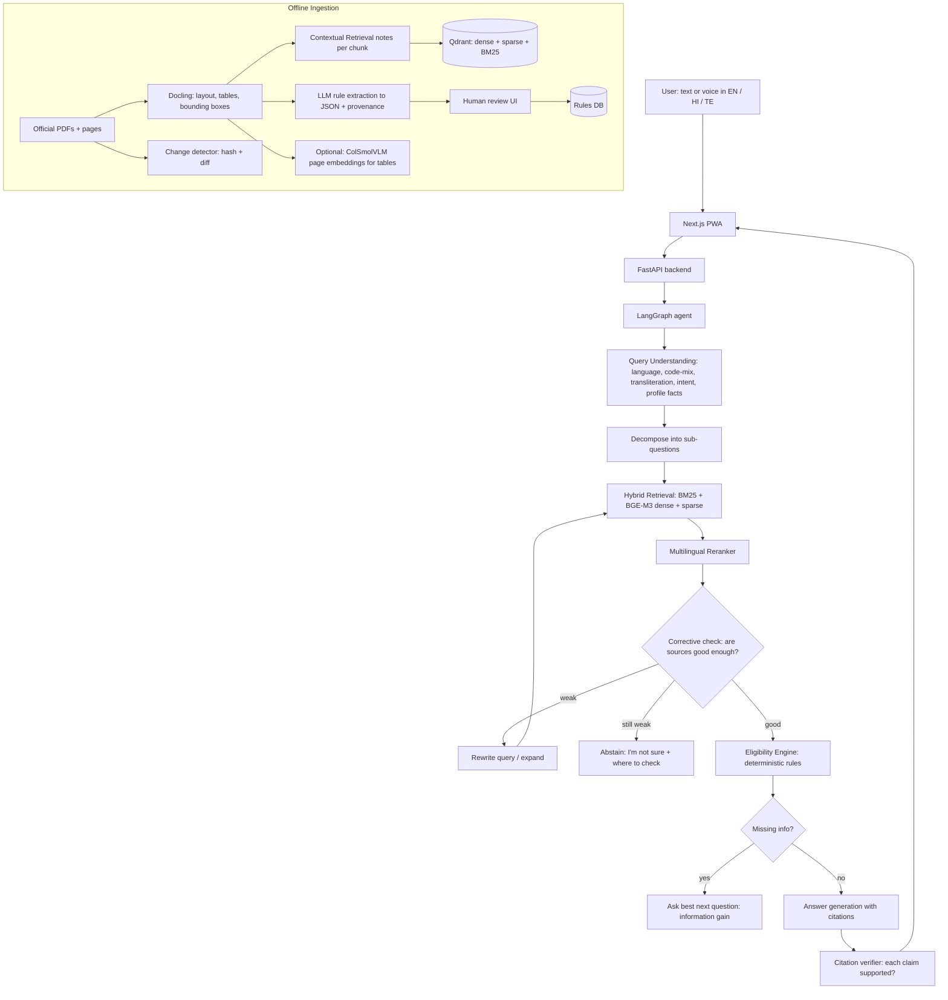

# Haathi — An Advanced Multilingual RAG Assistant for Government Schemes

> **Working name:** Haathi (हाथी, "elephant": an elephant never forgets). Mascot: **Gajju**, a friendly baby elephant. Rename anytime.
> **One line:** Ask in English, Hindi or Telugu (typed or spoken). Haathi finds the government schemes you're eligible for, proves it with exact citations, and tells you how to apply.
> **Budget:** ₹0 (free tiers, open-source models, free hosting)
> **Type:** website that installs like an app on phones (PWA)
> **Built on:** Mac (Apple Silicon)
> **Timeline:** 5 weeks
> **Author:** B. Sai Pranav

---

## 1. Why This Project Is Unique

Existing systems: **myScheme** (official portal: 4,700+ schemes, eligibility questionnaire, AI chatbot in Hindi and English) and **Jugalbandi** (open-source WhatsApp assistant for 170+ schemes). Haathi doesn't compete as a product. It goes further on **engineering and measurement**:

| # | Unique feature | Why it matters |
|---|---|---|
| 1 | **Eligibility engine with proof** | AI extracts each scheme's rules into structured JSON, each rule linked to the exact sentence in the official PDF. **Plain code** decides eligibility, the AI only explains. |
| 2 | **Smart questioning** | Haathi asks only the questions that matter, choosing each next question by how much it narrows down the schemes (information gain), like a smart "20 questions." |
| 3 | **"What if" answers** | "You'd qualify for PM-XYZ if your family income were below ₹2 lakh." Counterfactual eligibility from the rule engine. |
| 4 | **Code-mixed and transliterated input** | Understands Hinglish ("mera income 2 lakh hai"), Tenglish, and Telugu/Hindi typed in English letters. |
| 5 | **Highlighted citations** | Every claim links to the official PDF page with the exact passage highlighted. |
| 6 | **Calibrated "I don't know"** | Abstains when confidence is low; the threshold is tuned on the benchmark with a risk–coverage curve. |
| 7 | **Freshness tracking** | Detects when a scheme document changes, shows "rule changed on <date>," and warns about outdated sources. |
| 8 | **Open benchmark** | **SchemeQA-Indic** (working name): a human-verified multilingual question set released on Hugging Face. |
| 9 | **Measured design** | An ablation table proving which technique improved what. |
| 10 | **Delightful, accessible UI** | Gajju the elephant and animal animations that explain what the system is doing, with full Reduce Motion support. |

---

## 2. User Experience

### Example conversation

> **User (Telugu, by voice):** "నేను తెలంగాణలో రైతుని, 2 ఎకరాల భూమి ఉంది…" ("I'm a farmer in Telangana with 2 acres…")
>
> **Haathi:** *Gajju's ears perk up while listening, then he flips through pages while searching.*
> "To check the right schemes, two quick questions: What is your family's yearly income? Do you have a bank account linked to Aadhaar?" *(only the questions that matter)*
>
> **User:** "1.5 lakh, yes."
>
> **Haathi:** *A peacock fans its feathers and 3 scheme cards spread out like feathers.*
> **You're likely eligible for 3 schemes:**
> 1. **[Scheme A]**: ₹X/year. ✅ Land under limit · ✅ Income under limit · ✅ Bank account. *Source: Guidelines p.4 (highlighted)*
> 2. …
> **Almost eligible:** [Scheme D]: you'd qualify if your land were under 1 acre.
> **Documents to bring:** Aadhaar, land record, bank passbook.
> ⚠️ *Haathi is not a government service. Please confirm on the official portal.*

### Screens
1. **Welcome / onboarding:** pick language; Gajju waves; 3 quick slides.
2. **Chat:** voice or text; answers with scheme cards and citations.
3. **Eligibility check:** step-by-step questions with a progress trail.
4. **Scheme detail:** benefits, rules checklist (✅/❌ per rule), documents, how to apply, source viewer.
5. **Source viewer:** official PDF page with highlighted passage.
6. **Saved schemes:** bookmarked schemes and checklists.
7. **About / Trust:** sources, last updated dates, disclaimer, how Haathi works.

---

## 3. Architecture



### Key design principles
- **Numbers are never decided by the AI.** Income limits, ages and land sizes are checked by code.
- **Every claim has a source.** If a sentence can't be traced to a document, it's removed or marked uncertain.
- **Abstain over guessing.** A wrong "you're eligible" can waste a poor family's trip to an office.
- **Measure everything.** Every technique must earn its place in the ablation table.

---

## 4. Tech Stack (all free)

| Layer | Choice | Notes |
|---|---|---|
| Frontend | **Next.js 15 + TypeScript**, PWA | Installable on phones, works on slow networks |
| UI animation | **Motion** (Framer Motion) | Page, card, list and layout transitions |
| Mascot animation | **Rive** | One elephant file with a state machine (idle, listening, thinking, found, unsure, error); small file size |
| Animal micro-animations | **Lottie** (dotLottie) | Use free animations from LottieFiles (check each license) or make your own in Rive |
| Fonts | **Noto Sans, Noto Sans Devanagari, Noto Sans Telugu** | Proper rendering of all three scripts |
| Backend | **Python 3.12, FastAPI**, Pydantic | Async, typed |
| Agent flow | **LangGraph** | Clear graph with loops (corrective retrieval) and pauses (questions) |
| Document parsing | **Docling** | Layout, tables, page bounding boxes for highlights |
| Embeddings | **BGE-M3** | Multilingual (incl. Hindi, Telugu), dense + sparse in one model |
| Keyword search | **BM25** (`bm25s`) | Exact terms: scheme names, codes |
| Vector DB | **Qdrant** (local Docker or free cloud tier) | Hybrid search, multi-vector support |
| Reranker | **bge-reranker-v2-m3** | Multilingual cross-encoder |
| Visual retrieval (optional) | **ColSmolVLM** via `colpali-engine` | Index table-heavy pages once on free Colab GPU |
| LLM | **Gemini API** (free tier) | Fallback to a smaller Gemini model or local Ollama on rate limits |
| Speech-to-text | Gemini audio input, or AI4Bharat Indic ASR models | Compare quality for Telugu/Hindi |
| Text-to-speech | Browser speech synthesis, or AI4Bharat Indic TTS | Read answers aloud |
| Transliteration | `indic-transliteration` + LLM fallback | Telugu/Hindi typed in English letters |
| Observability | **Langfuse** (self-hosted, free) | Traces per question |
| Evals | Custom scripts + pytest | Benchmark, ablations, risk–coverage |
| Load test | **Locust** | p50/p95 latency under concurrent users |
| Hosting | Vercel (frontend), Render / Hugging Face Spaces (backend) | Free tiers; check limits |
| Dataset | **Hugging Face Datasets** | Publish the benchmark |

### 4.1 Developing on your Mac

Everything is built and tested on a Mac with Apple Silicon (M1 or newer).

**Install (all free):**

| Tool | Install | Used for |
|---|---|---|
| Homebrew | from brew.sh | Installing everything else |
| Python 3.12 + `uv` | `brew install uv` then `uv python install 3.12` | Backend, ingestion, evals |
| Node.js (LTS) | `brew install node` | Next.js frontend |
| OrbStack or Docker Desktop | `brew install --cask orbstack` | Running Qdrant and Langfuse in containers |
| Git + GitHub CLI | `brew install git gh` | Version control |
| Cursor | cursor.com | Coding with Claude |
| Rive (free plan) | rive.app | Designing Gajju |
| Figma (free plan) | figma.com | Icon and screen design |

**What runs locally on the Mac:**
- FastAPI, LangGraph, BM25, Docling.
- **BGE-M3 and the reranker** use the Mac's GPU through PyTorch **MPS** (`device="mps"`, with automatic CPU fallback). Indexing ~60 schemes takes minutes.
- Qdrant and Langfuse in OrbStack/Docker.
- The Next.js site at `http://localhost:3000`.

**What runs elsewhere:**
- **Gemini** runs in Google's cloud through the API.
- **ColSmolVLM visual indexing** (optional) runs once on **Google Colab's free GPU**; download the index and load it locally.

**Memory tips:**
- 16 GB RAM: run everything together.
- 8 GB RAM: keep Langfuse off unless debugging; index in small batches; close other heavy apps.

**Testing on a real phone:**
1. Start the frontend with `npm run dev -- -H 0.0.0.0`.
2. Find your Mac's IP: `ipconfig getifaddr en0`.
3. On your phone (same Wi-Fi), open `http://<Mac-IP>:3000`.
4. Microphone access needs HTTPS on phones; for voice testing, use a free tunnel (e.g. `cloudflared tunnel --url http://localhost:3000`) or test voice after deploying to Vercel.

**Project scripts (in a `Makefile`):**
- `make setup` installs Python and Node dependencies.
- `make services` starts Qdrant (and Langfuse if needed).
- `make ingest` downloads, parses and indexes documents.
- `make dev` runs backend and frontend together.
- `make eval` runs the benchmark and ablations.

---

## 5. Data & Corpus

### Scope for v1 (keep it focused)
- **~60–100 schemes:** central schemes + **Telangana** and **Andhra Pradesh** schemes.
- **Categories:** farmers, students (scholarships), women, senior citizens, housing, health insurance.
- **Sources:** official ministry and state department PDFs and pages only. Check each site's terms and robots.txt; download politely; store the source URL and download date for every file.

### Ingestion pipeline
1. **Download** official documents, save URL, date and SHA-256 hash.
2. **Parse** with Docling: text blocks, tables (as structured tables), headings, page numbers, bounding boxes.
3. **Chunk** by document structure (sections, table rows with headers), not fixed size. Compare against fixed-size chunking in ablations.
4. **Contextual Retrieval:** for each chunk, generate a 1–2 sentence note ("This chunk is from the eligibility section of [Scheme] guidelines, 2025") and prepend it before indexing. Cache results.
5. **Index** in Qdrant: BGE-M3 dense + sparse vectors, plus BM25.
6. **Rule extraction:** LLM converts eligibility sections into the Rule DSL (Section 6) with the source span for each rule.
7. **Human review:** a small admin page where you approve or fix each extracted rule (side by side with the highlighted source). Track how many rules needed fixing; that's a metric.
8. **Freshness:** weekly re-download; if the hash changes, diff the text, re-extract rules, mark the scheme "changed," and keep the old version.

---

## 6. The Eligibility Engine (core differentiator)

### Rule DSL (stored as JSON)

```json
{
  "scheme_id": "ts_farmer_support_2025",
  "version": "2025-06",
  "rules": [
    {
      "id": "r1",
      "field": "occupation",
      "op": "in",
      "value": ["farmer"],
      "source": {"doc": "ts_farmer_guidelines.pdf", "page": 4, "quote": "All farmers owning agricultural land…", "bbox": [72, 310, 520, 348]}
    },
    {
      "id": "r2",
      "field": "land_acres",
      "op": "lte",
      "value": 5,
      "source": {"doc": "ts_farmer_guidelines.pdf", "page": 4, "quote": "…up to 5 acres…", "bbox": [72, 352, 400, 370]}
    },
    {
      "id": "r3",
      "field": "state",
      "op": "eq",
      "value": "Telangana",
      "source": {"doc": "ts_farmer_guidelines.pdf", "page": 1, "quote": "Government of Telangana…", "bbox": [100, 80, 480, 100]}
    }
  ],
  "logic": "r1 AND r2 AND r3",
  "benefit": {"summary": "₹X per acre per season", "source": {"doc": "ts_farmer_guidelines.pdf", "page": 5}},
  "documents_required": ["Aadhaar", "Land record (Pattadar passbook)", "Bank passbook"],
  "how_to_apply": {"summary": "...", "source": {"doc": "...", "page": 6}}
}
```

### How it works
- **User profile** (fields like state, age, income, occupation, land, category, gender) is built from the conversation. Each fact remembers where it came from ("user said 1.5 lakh").
- **Evaluator** (plain Python): for each scheme, every rule returns `pass`, `fail` or `unknown` (missing info). Scheme status: **eligible**, **not eligible**, **maybe** (unknowns remain).
- **Explanations:** ✅/❌/❓ per rule with its source quote.
- **What-if:** for "not eligible" schemes that fail only one numeric rule, compute the threshold ("eligible if income ≤ ₹2,00,000").

### Smart questioning (information gain)
- Among schemes still "maybe," find the missing fields.
- For each candidate question, estimate how many schemes it would resolve (or the expected entropy reduction across schemes' eligible / not-eligible outcomes).
- Ask the single best question next. Stop when every relevant scheme is resolved or the user stops.
- **Measure:** average number of questions to reach a decision vs. a fixed questionnaire (like myScheme's). This is a strong algorithmic result for interviews.

### Privacy
- Profile is stored **on the user's device** (browser storage) by default; the server keeps it only for the session.
- **Never ask for or store Aadhaar numbers, bank account numbers or phone numbers.** Only "do you have…?" questions.

---

## 7. Retrieval & Generation Pipeline (LangGraph nodes)

| Node | What it does |
|---|---|
| `understand` | Detect language and script, code-mixing, transliteration → normalized query; extract profile facts; classify intent (find schemes / ask about one scheme / documents / how to apply / chit-chat) |
| `decompose` | Split multi-part questions into sub-questions |
| `retrieve` | Hybrid search: BM25 + BGE-M3 dense + sparse, fused with Reciprocal Rank Fusion; optional visual retrieval for table pages |
| `rerank` | Multilingual cross-encoder, keep top 5–8 |
| `grade` | Corrective step: are the top passages relevant enough (reranker score + LLM check)? |
| `rewrite` | If weak: rewrite / translate / expand query and retry once |
| `abstain` | If still weak: "I'm not sure," with links to official sources |
| `eligibility` | Run the rule engine for schemes found |
| `ask` | If unknowns matter: pick the best next question |
| `generate` | Answer in the user's language with numbered citations; structured JSON → UI cards |
| `verify` | Check each claim against its cited passage (NLI-style LLM check); remove or flag unsupported claims |
| `respond` | Stream to UI with animation events (Section 9) |

### Cross-lingual strategy (compare in ablations)
- **A:** embed the original Telugu/Hindi query directly (BGE-M3 is multilingual).
- **B:** translate the query to English first, then retrieve.
- **C:** both, fused.
Report which works best per language.

---

## 8. UI Design

### Visual style
- **Colors:** warm and trustworthy. Peacock blue (primary), marigold (accent), leaf green (eligible), soft red (not eligible), sand (background). Full dark mode.
- **Typography:** Noto Sans family; larger default size (17px) for readability.
- **Accessibility:** WCAG AA contrast, 48px touch targets, screen-reader labels on every animation, captions for voice, works on low-end Android phones.
- **Trust elements:** disclaimer always visible on answers, "last verified" dates, source links.

### App icon & branding

**Concept:** Gajju's head (front view, ears spread, trunk curled up like a friendly "hello") in white, on a **peacock blue** rounded square, with a small **marigold** dot or leaf near the trunk. Simple shapes so it stays clear at tiny sizes.

**Rules:**
- **No government symbols:** no national emblem, flag colors as the main theme, or official logos. It must not look like an official app.
- Recognizable at 16 px: no text inside the icon, thick shapes, high contrast.
- One master **SVG** file; export everything else from it.

**Files needed (in `frontend/public/icons/`):**

| File | Size | Used for |
|---|---|---|
| `icon.svg` | vector | Master file, modern browsers' favicon |
| `favicon.ico` | 16 + 32 px | Older browsers |
| `icon-192.png` | 192×192 | Android home screen (PWA) |
| `icon-512.png` | 512×512 | Android splash screen, install prompt |
| `icon-maskable-512.png` | 512×512 (logo in the central 80% "safe zone") | Android adaptive icons (circle, squircle shapes) |
| `icon-monochrome.svg` | vector, single color | Android themed (monochrome) icons |
| `apple-touch-icon.png` | 180×180, no transparency | iPhone "Add to Home Screen" |
| `og-image.png` | 1200×630 | Link previews on WhatsApp, LinkedIn, X |

**Web app manifest (`frontend/app/manifest.ts`):**
- `name`: "Haathi – Find Government Schemes", `short_name`: "Haathi"
- `theme_color`: peacock blue, `background_color`: sand
- `display`: "standalone", `start_url`: "/"
- `icons`: the 192, 512 and maskable 512 entries (with `"purpose": "maskable"` on the maskable one)

**Animated icon moments:**
- **Splash screen:** the icon's Gajju blinks and waves his trunk once (Rive), then fades into the welcome screen.
- **Install prompt:** a small card with the icon; Gajju bounces gently to draw attention once, not repeatedly.
- **Loading tab favicon (optional):** favicon swaps to a "thinking Gajju" frame while an answer is generating.

**Tools:** design in **Figma** (free) or Rive; export PNGs with a free tool such as **RealFaviconGenerator** or a small script using `sharp`; test the maskable icon with **maskable.app**.

### Layout (mobile first)
- Top: language switcher (EN / हिं / తె), Gajju in the corner.
- Middle: chat with scheme cards.
- Bottom: large mic button + text field.
- Desktop: chat on the left, source viewer on the right.

---

## 9. Animation System (with animals)

### 9.1 Rules
1. **Animations never slow down answers.** Text streams immediately; animations play alongside.
2. **Every animation means something.** Animals represent real system steps, so users understand what's happening.
3. **Respect Reduce Motion:** `prefers-reduced-motion` replaces movement with simple fades; mascot shows static poses.
4. **Performance budget:** each Lottie file under 60 KB, the Rive mascot under 150 KB, 60 fps on mid-range Android; lazy-load non-essential animations.
5. **"Animation level" setting:** Full / Calm / Off.
6. **Accessible:** every animation has an `aria-label` or is `aria-hidden` with equivalent text.

### 9.2 Gajju the elephant (Rive state machine)

| State | Trigger | Animation |
|---|---|---|
| `idle` | Nothing happening | Gentle breathing, ears flap slowly, blinks every few seconds |
| `wave` | First open, onboarding | Raises trunk and waves |
| `listening` | Mic active | Ears perk up and widen; sound-wave rings pulse from the ears with voice volume |
| `thinking` | Retrieving | Wears tiny glasses, flips through a stack of papers with the trunk |
| `asking` | Haathi asks a question | Tilts head, a "?" bubble pops up |
| `found` | Eligible schemes found | Happy trumpet, small confetti of marigold petals |
| `unsure` | Abstaining | Shrugs, honest smile, points trunk at "Check official portal" |
| `not_eligible` | No schemes match | Gentle comforting pat; shows "almost eligible" schemes |
| `error` | Server or network error | Sleepy elephant with "Zzz"; wakes up on retry |
| `language_switch` | Language changed | Turns around and comes back wearing a small cap with the language's letter (A / अ / అ) |
| `celebrate` | User saves a checklist or finishes the flow | Spins once, sprays a sparkle fountain from the trunk |

Inputs into the state machine: `isListening`, `stage` (number), `result` (enum), `voiceLevel` (0–1).

### 9.3 Animal animations for each system step

| # | Moment | Animal | Animation | Tech |
|---|---|---|---|---|
| 1 | **Retrieval in progress** | 🐜 Ants | A line of ants carries small document "chunks" across the top of the chat toward Gajju. The number of ants matches the number of passages found | Lottie / CSS sprite |
| 2 | **Reranking** | 🐜 Ants | Ants reorder themselves; the best chunks move to the front | Motion layout animation |
| 3 | **Corrective retry** | 🐜 Ants | Ants turn around and take a different path ("searching another way…") | Lottie |
| 4 | **Citation verification** | 🦉 Owl | An owl with a magnifying glass looks at each citation chip; chips get a ✓ as verified | Lottie + Motion |
| 5 | **Eligible schemes reveal** | 🦚 Peacock | Peacock fans its feathers; scheme cards spread out from the center like feathers, staggered | Lottie + Motion stagger |
| 6 | **Translation / language detection** | 🦜 Parrot | Parrot appears beside the message, "repeats" it, and the text morphs into the target script | Lottie + text crossfade |
| 7 | **Save scheme** | 🐿️ Squirrel | Squirrel grabs the card like an acorn and runs into the "Saved" tab icon, which bounces | Motion path + Lottie |
| 8 | **Slow network** | 🐢 Tortoise | After 3 seconds of waiting, a tortoise walks across with "Slow network, still working…" | Lottie |
| 9 | **Eligibility checklist** | 🐘 Gajju | Each rule row ticks ✅ in sequence; Gajju nods for each pass, tilts head for ❓ | Rive + Motion stagger |
| 10 | **What-if result** | 🦋 Butterfly | A butterfly flies from the failing rule to the "almost eligible" card, leaving a dotted trail | Motion path |
| 11 | **Document checklist complete** | 🐝 Bees | Bees fly in and "fill" each checklist item like honeycomb cells | Lottie |
| 12 | **Freshness warning** | 🦎 Chameleon | Chameleon changes color on cards whose source changed recently: "This rule changed on <date>" | Lottie |
| 13 | **Empty state (no chats yet)** | 🐘 + 🐦 | Gajju sitting under a tree, a small bird on his head, suggested questions float like leaves | Rive + Motion |
| 14 | **Onboarding slides** | 🐘 🦚 🦉 | Each slide introduces one helper animal and what it does (search, verify, reveal) | Rive + page transitions |
| 15 | **Mic button** | 🐘 | Mic button is shaped like Gajju's ear; it ripples with voice level | Rive input `voiceLevel` |
| 16 | **Pull to refresh** | 🐒 Monkey | A monkey swings down on a vine as you pull, lets go on release | Lottie scrubbed by pull distance |
| 17 | **Feedback (thumbs up)** | 🐘 | Gajju gives a small happy hop | Rive |
| 18 | **Feedback (thumbs down)** | 🦉 | Owl writes in a notebook: "Thanks, we'll check this answer" | Lottie |
| 19 | **Long answer loading (skeleton)** | 🐜 | Skeleton lines are "built" by ants placing blocks | CSS + Motion |
| 20 | **Offline mode** | 🌙 Fireflies | Night scene, fireflies glow around saved schemes (available offline) | Lottie |

### 9.4 Non-animal UI animations (Motion)

| Moment | Animation |
|---|---|
| Message appear | Fade + 8px slide up, spring |
| Streaming text | Words fade in; blinking caret |
| Scheme card expand | Shared layout animation into the detail screen |
| Citation chip tap | Chip expands into the source viewer (shared element) |
| Source highlight | PDF page zooms to the passage; a marigold highlight sweeps left to right |
| Rule rows | Staggered ✅/❌ ticks with a small scale bounce |
| Benefit amount | Numbers count up (₹0 → ₹6,000) |
| Language switch | Text crossfades with a slight blur between scripts |
| Tabs | Sliding underline indicator |
| Buttons | Press scale 0.97, spring back |
| Toasts | Slide up from bottom, auto-dismiss with a shrinking progress bar |
| Errors | Small horizontal shake on the input |

### 9.5 Animation event protocol
The backend streams events so animations match real progress:

```json
{"type": "stage", "stage": "retrieve", "count": 12}
{"type": "stage", "stage": "rerank"}
{"type": "stage", "stage": "retry", "reason": "low_relevance"}
{"type": "stage", "stage": "verify", "citation_id": 3, "status": "supported"}
{"type": "result", "kind": "eligible", "schemes": 3}
{"type": "token", "text": "..."}
```

The frontend maps each event to Gajju's state machine and the animal animations.

---

## 10. Evaluation (the most important part)

### 10.1 SchemeQA-Indic benchmark
- **150+ questions:** 50 English, 50 Hindi, 50 Telugu, including code-mixed and transliterated ones.
- **Types:** factual ("what is the benefit of X?"), eligibility ("am I eligible if…"), documents, how to apply, comparisons, multi-hop, **unanswerable** (to test abstention), and outdated-info traps.
- **Each item:** question, language, gold answer, gold source (doc + page), gold eligible schemes (for profile questions).
- Built by you and verified against official sources; ideally a second person checks a sample.
- **Release** on Hugging Face with a datasheet: how it was made, license, limitations.

### 10.2 Metrics

| Metric | Measures |
|---|---|
| Recall@5 / MRR | Did retrieval find the right source? |
| Answer correctness | Matches the gold answer (LLM judge + manual check of a sample) |
| Faithfulness | Every claim supported by its citation |
| Citation precision | Cited passages actually support the claims |
| Eligibility accuracy / F1 | Correct eligible-scheme sets for profile questions |
| Abstention quality | Correctly abstains on unanswerable; risk–coverage curve |
| Questions-to-decision | Average questions asked by smart questioning vs fixed questionnaire |
| Cross-lingual gap | Score difference: English vs Hindi vs Telugu |
| Latency | p50 / p95 time to first token and full answer |
| Cost | Tokens and estimated cost per question |

### 10.3 Experiments
1. **Ablation table:** naive RAG → + hybrid → + reranker → + Contextual Retrieval → + structure-aware chunking → + corrective loop → + citation verifier.
2. **Eligibility:** LLM-only vs rule engine (accuracy on profile questions).
3. **Cross-lingual:** strategies A / B / C (Section 7).
4. **Tables:** text-only parsing vs Docling tables vs visual retrieval on table-heavy questions.
5. **Questioning:** information-gain vs fixed order.
6. **Abstention threshold:** pick the threshold from the risk–coverage curve.

### 10.4 Load and reliability
- Locust test: 20 and 50 concurrent users; report p50/p95 latency and error rate.
- Caching: identical normalized questions served from cache; measure hit rate.
- Rate-limit handling: fallback model; queue; friendly message (and tortoise 🐢).

---

## 11. Safety & Responsibility

- **Disclaimer** on every answer: not a government service; confirm on official portals.
- **No false affiliation:** no government logos or the national emblem.
- **No sensitive IDs** collected; profile kept on device by default.
- **Prompt-injection guard** on ingested documents and user input (data blocks, pattern checks).
- **Abstain** rather than guess on eligibility and amounts.
- **Feedback button** to report wrong answers; reviewed weekly; wrong answers become new benchmark items.
- **Accessibility first:** voice, large text, simple language mode.

---

## 12. Project Structure

```
haathi/
├── backend/
│   ├── app/
│   │   ├── main.py                 # FastAPI, SSE streaming
│   │   ├── graph/                  # LangGraph nodes (Section 7)
│   │   ├── retrieval/              # bm25, dense/sparse, fusion, rerank, visual
│   │   ├── eligibility/            # rule DSL, evaluator, what-if, info-gain questioner
│   │   ├── language/               # detection, transliteration, translation
│   │   ├── speech/                 # ASR / TTS adapters
│   │   ├── verify/                 # citation verifier
│   │   ├── llm.py                  # Gemini + fallback
│   │   └── models.py
│   ├── ingestion/                  # download, docling parse, chunk, contextualize, index, rule extraction, freshness
│   ├── admin/                      # rule review UI (simple)
│   └── tests/
├── frontend/
│   ├── app/                        # Next.js routes
│   ├── components/                 # Chat, SchemeCard, RuleChecklist, SourceViewer, MicButton…
│   ├── animations/
│   │   ├── gajju.riv               # mascot state machine
│   │   ├── lottie/                 # ants, owl, peacock, parrot, squirrel, tortoise, bees, chameleon, monkey, fireflies, butterfly
│   │   ├── motion.ts               # Motion presets (springs, staggers)
│   │   └── useAnimationEvents.ts   # maps backend events → animations
│   ├── i18n/                       # en, hi, te strings
│   └── public/
│       └── icons/                  # icon.svg, favicon, 192/512/maskable PNGs, apple-touch-icon, og-image
├── eval/
│   ├── schemeqa/                   # benchmark data
│   ├── run_eval.py
│   ├── ablations.py
│   └── reports/
├── data/                           # downloaded docs (gitignored), manifests (committed)
├── docker-compose.yml              # qdrant, langfuse, backend
├── Makefile                        # setup, services, ingest, dev, eval (Mac)
└── README.md
```

---

## 13. Five-Week Roadmap

| Week | Focus | Done when… |
|---|---|---|
| 1 | Corpus (~60 schemes), Docling ingestion, chunking, Qdrant hybrid index, baseline RAG API, first 50 benchmark questions | Baseline answers with citations; baseline scores recorded |
| 2 | Reranker, Contextual Retrieval, corrective loop, abstention, citation verifier, cross-lingual strategies, full 150 benchmark | Ablation table v1 |
| 3 | Rule extraction + review UI, eligibility engine, what-if, smart questioning | Eligibility accuracy: rule engine vs LLM-only |
| 4 | Next.js frontend, Gajju (Rive), animal animations, event protocol, source viewer with highlights, voice, i18n | Full flow works on a phone with animations |
| 5 | Load test, caching, freshness tracker, Hugging Face dataset release, deployment, real users (10–20), README + write-up + demo video | Live link, published benchmark, real usage numbers |

---

## 14. Cursor Prompts

**How to use:** commit before each prompt, one prompt per chat, ask Claude to plan first, review, then "go ahead." Keep this file (`haathi.md`) in the repo root.

### Prompt 1 — Ingestion + baseline RAG

```
Read haathi.md. Build the ingestion pipeline and a baseline RAG API (Sections 4, 4.1, 5, 7). Plan first. I'm developing on a Mac with Apple Silicon.

- Python 3.12 backend with FastAPI and Pydantic, managed with uv; docker-compose with Qdrant (works with OrbStack or Docker Desktop).
- Makefile with setup, services, ingest, dev and eval targets (Section 4.1).
- Load embedding and reranker models on device="mps" when available, falling back to CPU.
- ingestion/: download script reading a manifest (CSV of scheme name, state, category, official URL); save file, URL, date, SHA-256. Polite downloading (delay, robots.txt check, clear user agent).
- Parse PDFs/HTML with Docling: keep headings, tables (as structured rows with headers), page numbers, bounding boxes.
- Structure-aware chunking (sections; tables chunked by rows with headers repeated) plus a fixed-size chunker for comparison.
- Index in Qdrant with BGE-M3 dense + sparse vectors; build a BM25 index with bm25s.
- Baseline /ask endpoint: dense-only retrieval, top 5, Gemini answer with numbered citations (doc, page), streaming via SSE.
- eval/: benchmark JSONL format from Section 10.1 and run_eval.py computing Recall@5, MRR, and LLM-judged correctness and faithfulness.

Done when: /ask answers with citations and run_eval.py prints baseline scores.
```

### Prompt 2 — Advanced retrieval

```
Add advanced retrieval (haathi.md Section 7, 10.3). Plan first.

- Hybrid retrieval: BM25 + BGE-M3 dense + sparse, fused with Reciprocal Rank Fusion.
- Reranker: bge-reranker-v2-m3, keep top 5-8.
- Contextual Retrieval: at ingestion, generate a 1-2 sentence context note per chunk with Gemini (cached on disk), prepend before embedding and BM25.
- Every technique behind a config flag so ablations can toggle it.
- eval/ablations.py: runs the benchmark for each configuration in order (naive, +hybrid, +rerank, +contextual, +structure-aware chunking) and writes a markdown table to eval/reports/.

Done when: the ablation table is generated with real numbers.
```

### Prompt 3 — Multilingual + LangGraph agent

```
Build the LangGraph agent and multilingual handling (haathi.md Section 7). Plan first.

- Nodes: understand, decompose, retrieve, rerank, grade, rewrite, abstain, generate, verify, respond (eligibility and ask come later; leave hooks).
- understand: detect language and script (en/hi/te), code-mixing, Latin-script Hindi/Telugu (transliterate with indic-transliteration, LLM fallback); extract profile facts with source spans; classify intent.
- Cross-lingual strategies A (direct), B (translate to English), C (both fused) behind a config flag; add to ablations with per-language scores.
- grade: reranker score threshold + LLM relevance check; rewrite once if weak; abstain if still weak, with official links.
- verify: check each claim against its cited passage; drop or flag unsupported claims.
- generate answers in the user's language, structured JSON for UI cards plus text.
- Stream animation events per Section 9.5 over SSE.
- Langfuse tracing for every node.

Done when: Telugu, Hindi, Hinglish and English questions all work, unanswerable questions abstain, and per-language scores appear in reports.
```

### Prompt 4 — Eligibility engine

```
Build the eligibility engine (haathi.md Section 6). Plan first. This is the core differentiator; keep it deterministic and well tested.

- Rule DSL as Pydantic models (field, op in {eq, neq, in, not_in, lt, lte, gt, gte, between, exists}, value, source with doc/page/quote/bbox), logic expression (AND/OR/NOT with parentheses), benefit, documents_required, how_to_apply.
- Rule extraction: Gemini converts eligibility sections into the DSL with source quotes; validate that each quote exists in the parsed text (exact or fuzzy match) or reject it.
- Admin review page (simple FastAPI + HTML): rule list beside the highlighted source; approve / edit / reject; track the % of rules needing edits.
- Evaluator: pass/fail/unknown per rule, scheme status eligible / not eligible / maybe, explanation per rule with source.
- What-if: for schemes failing exactly one numeric rule, compute the threshold message.
- Profile model with fact provenance; stored client-side by default.
- 100% unit-test coverage for the evaluator and logic parser; property-based tests with hypothesis.
- Experiment: eligibility accuracy of LLM-only answers vs rule engine on the benchmark's profile questions; write the result to reports.

Done when: tests pass and the eligibility comparison table is generated.
```

### Prompt 5 — Smart questioning

```
Add smart questioning (haathi.md Section 6, "Smart questioning"). Plan first.

- For schemes in "maybe" status, collect missing fields.
- Score each candidate field by expected information gain over scheme outcomes (use simple priors per field from the corpus; document the formula).
- Ask the best next question in the user's language with suitable input type (number, yes/no, choice).
- Stop when all relevant schemes are resolved or after a max of 6 questions.
- Experiment: average questions-to-decision vs a fixed-order questionnaire on 30 synthetic profiles; write results to reports.

Done when: the agent asks fewer questions than the fixed order on average and the report shows the numbers.
```

### Prompt 6 — Frontend + core UI

```
Build the Next.js 15 PWA frontend (haathi.md Sections 2, 8, 9.4). Plan first.

- Screens: onboarding, chat, eligibility flow, scheme detail, source viewer, saved schemes, about/trust.
- i18n for en/hi/te with Noto Sans fonts; language switcher.
- Chat with SSE streaming, scheme cards, rule checklist (✅/❌/❓ with source quotes), document checklist, what-if cards, disclaimer on every answer.
- Source viewer: render the PDF page (pdf.js) and highlight the cited bbox; animate zoom + highlight sweep.
- Motion animations from Section 9.4 using shared presets in animations/motion.ts.
- Profile stored in localStorage (wrapped in try/catch); "Clear my data" button.
- PWA setup from Section 8 "App icon & branding": app/manifest.ts, all icon files in public/icons (start with a placeholder Gajju SVG and generate PNG sizes with a sharp script), apple-touch-icon, og-image, theme color; installable on Android and iPhone.
- Dev server reachable from my phone on the same Wi-Fi (Section 4.1).
- Accessibility: WCAG AA contrast, 48px touch targets, aria labels, keyboard navigation, prefers-reduced-motion support, Animation level setting (Full / Calm / Off).

Done when: the full flow works on a phone screen with smooth transitions.
```

### Prompt 7 — Gajju and animal animations

```
Add Gajju and the animal animations (haathi.md Sections 9.1-9.3, 9.5). Plan first.

- Integrate a Rive file (frontend/animations/gajju.riv) with a state machine: idle, wave, listening, thinking, asking, found, unsure, not_eligible, error, language_switch, celebrate; inputs isListening, stage, result, voiceLevel. Until the real Rive file is designed, build a placeholder component with the same API (simple SVG elephant animated with Motion) so the app works.
- useAnimationEvents.ts maps backend SSE events to Gajju states and animal animations.
- Implement the 20 animal moments in Section 9.3 with Lottie (dotLottie) or Motion. Create an AnimalLayer component that plays the right animation without blocking text streaming.
- Lazy-load Lottie files; each under 60 KB; skip animations when Animation level is Off or Reduce Motion is on (show text equivalents).
- Add a /playground page to preview every animation and Gajju state.
- Document the license of every third-party animation in animations/LICENSES.md.

Done when: asking a question shows ants during retrieval, the owl verifying citations, the peacock revealing schemes, and Gajju reacting, all at 60 fps on a mid-range phone.
```

### Prompt 8 — Voice

```
Add voice input and output (haathi.md Sections 4, 9.2). Plan first.

- Mic button shaped like Gajju's ear, rippling with voice level (Rive input voiceLevel).
- Speech-to-text: adapter with two backends (Gemini audio input; AI4Bharat Indic ASR model if feasible) and an experiment comparing word error rate on 20 recorded test clips per language.
- Text-to-speech: browser speech synthesis with a fallback adapter; "Read aloud" button on answers.
- Captions for all audio.

Done when: a Telugu voice question gets a Telugu answer that can be read aloud, and the ASR comparison is in reports.
```

### Prompt 9 — Freshness, performance, deployment

```
Add freshness tracking, performance work, and deployment (haathi.md Sections 5, 10.4, 13). Plan first.

- Freshness: weekly re-download job; on hash change, diff text, re-extract rules, keep old versions, mark scheme as changed with date; chameleon animation on changed cards.
- Caching of normalized questions; measure hit rate.
- Gemini rate-limit handling with fallback model and a queue; tortoise animation for slow responses.
- Locust load test at 20 and 50 users; report p50/p95 latency and error rate.
- Deploy frontend to Vercel and backend to Render or Hugging Face Spaces (free tiers); Qdrant local file mode or free cloud tier; environment variables for keys (never in the frontend).

Done when: the live link works and the load test report exists.
```

### Prompt 10 — Benchmark release, README, write-up

```
Prepare the public release (haathi.md Sections 10, 15). Plan first.

- Publish SchemeQA-Indic on Hugging Face with a datasheet (creation process, languages, verification, license, limitations).
- README: problem, demo GIFs (Gajju + animals), architecture diagram, unique features, all result tables (ablations, eligibility comparison, cross-lingual, questioning, ASR, load test), how to run locally, limitations, disclaimer, comparison with myScheme and Jugalbandi.
- docs/writeup.md: a short technical report (problem, approach, experiments, results, failures, future work) for my portfolio site.
- Remove secrets, personal data and downloaded documents from the repo (keep manifests only).

Done when: the dataset page is live, the README is complete with real numbers, and the write-up is ready.
```

---

## 15. Resume Entry (fill in real numbers only)

> **Haathi – Multilingual RAG for Government Schemes** (Python, FastAPI, LangGraph, Gemini, Qdrant, Next.js)
> • Built a cross-lingual RAG assistant (English/Hindi/Telugu, voice + code-mixed input) over [N] official scheme documents with hybrid retrieval, reranking, Contextual Retrieval, corrective retries and verified page-level citations.
> • Designed a deterministic eligibility engine on LLM-extracted, source-linked rules with information-gain questioning, reaching [X]% eligibility accuracy vs [Y]% LLM-only and [Z] fewer questions per decision.
> • Released SchemeQA-Indic, a [150]-question human-verified benchmark on Hugging Face; ablations raised answer correctness from [A]% to [B]% at [p95] latency; used by [N] people.

---

## 16. Risks & Mitigations

| Risk | Mitigation |
|---|---|
| Scope too big | Keep v1 to ~60 schemes and 2 states; the animations come in week 4 after the core works |
| Gemini free-tier limits | Cache, fallback model, small batches at ingestion |
| Wrong eligibility answer | Rule engine + human-reviewed rules + abstention + disclaimer |
| Telugu ASR quality | Measure; offer text input; show the transcript for correction |
| Too many animations feel slow or childish | Animation level setting, Calm mode default for older users, strict performance budget, animations explain real steps |
| Third-party animation licenses | Use only free-licensed Lottie files or create your own; document in LICENSES.md |
| Outdated scheme info | Freshness tracker, "last verified" dates, chameleon warnings |

---

## 17. Next Step

1. Create the repo, put `haathi.md` in the root.
2. Make the manifest of ~60 schemes (Telangana, Andhra Pradesh, central) from official sources.
3. Run **Prompt 1** in Cursor.
